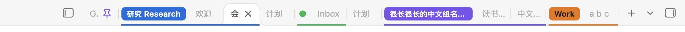
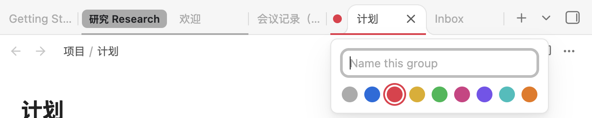
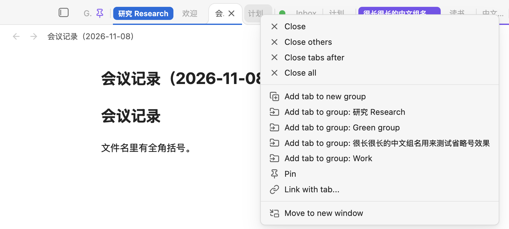
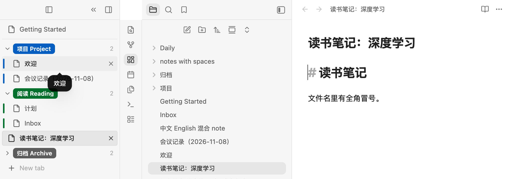
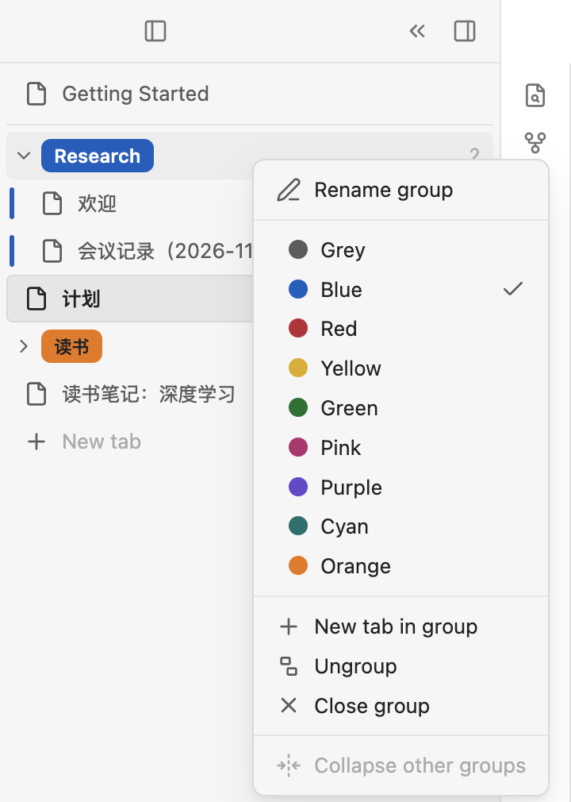
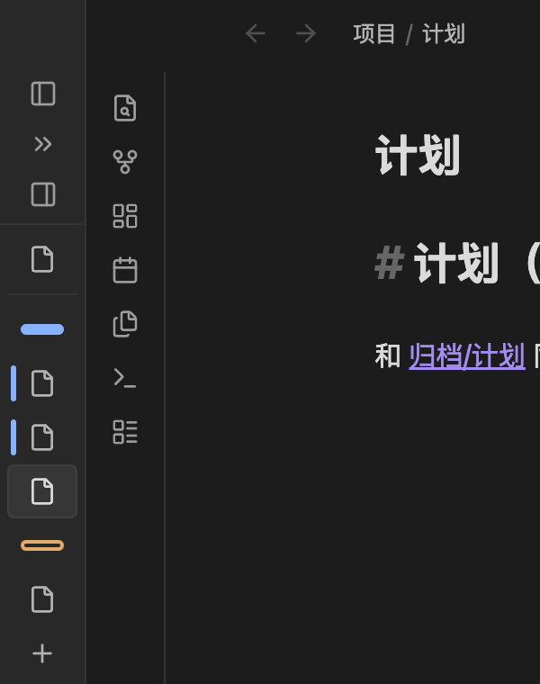

# Tabstrip

Tabstrip brings browser-style tab groups to Obsidian's own tab bar. Put tabs into named, coloured, collapsible groups, as in Chrome or Edge. An optional vertical tab strip (experimental) shows the same groups as a list at the left edge of the window.

Desktop only. Version 0.2.0. [中文说明](README.zh-CN.md)

## What it does

- **Groups on the real tab bar.** A group is a run of neighbouring tabs in one pane. It shows as a coloured chip with the group's name before its first tab (a colour dot when it has no name) and a coloured line under its tabs. Nine colours, as in Chrome.
- **Collapse and expand.** Click a chip to hide the group's tabs behind it; click again to show them. The tab you are looking at is never hidden: collapsing its group switches to a neighbouring tab, and a hidden tab that becomes active (Obsidian's "Go to tab #N", next / previous tab, the tab list, links, other plugins) opens its group again.
- **Drag tabs in and out of groups** with Obsidian's normal tab drag. While you drag, the group the tab would join is highlighted. Dragging a tab to another pane or window takes it out of its group.
- **Groups come back after a restart**, per device: names, colours, collapsed state and order, in the main window and in pop-out windows. Obsidian's "Undo close tab" puts a tab back into its group.
- **Vertical tab strip (experimental).** One command switches the main window to a vertical list of tabs at the far left: pinned tabs, then one section per pane, with group rows, coloured bars, close buttons, drag and drop, full keyboard support, and a 48 px icon bar that opens on hover. Both orientations share the same groups, so you can switch back and forth at any time.
- **English and Simplified Chinese** interface, keyboard access, screen reader labels, and high-contrast (forced colours) support.

| Name and colour a new group | Tab menu |
|---|---|
|  |  |

## Quick start

1. Install and enable Tabstrip (see [Installation](#installation)).
2. Right-click a tab and choose **Add tab to new group**. A small bubble opens: type a name and pick a colour, then press Enter or click elsewhere (Escape cancels the changes).
3. Right-click another tab of the same pane and choose **Add tab to group: …**, or drag it between the group's tabs.
4. Click the group's chip to collapse it. Right-click the chip to rename, recolour, open a new tab in the group, ungroup, close the group or collapse the other groups.
5. Optional: open the command palette and run **Tabstrip: Toggle vertical tabs (experimental)** to try the vertical strip. Run it again to go back.

Tabstrip has no settings tab. Everything is done with menus and commands, and no command has a default hotkey.

## Horizontal and vertical

The horizontal tab bar is the default. The command **Toggle vertical tabs (experimental)** (Chinese interface: **切换垂直标签栏（实验）**) switches the main window between the two. It has no default hotkey; to bind one, open **Settings → Hotkeys** and search for "Tabstrip".

Switching keeps your groups, pinned tabs, collapsed groups, the tab order, the active tab and the cursor. The layout and `workspace.json` do not change. The choice is stored per device and survives a restart. Pop-out windows always keep the horizontal tab bar.

| Vertical strip | Group menu | Icon bar |
|---|---|---|
|  |  |  |

In the vertical strip:

- **Mouse.** Click a row to show the tab; middle-click it or click its × to close it. Right-click a tab for Obsidian's own tab menu (with the group items), right-click a group row for the group menu. Click a group row to collapse or expand the group.
- **Icon bar.** The button in the strip's header, or the command **Collapse/expand vertical tab strip**, shrinks the strip to a 48 px bar of icons. Hovering the bar opens it over the workspace without moving anything.
- **Width.** Drag the strip's right edge (or focus it and press Arrow Left / Right): 180 to 480 px.
- **Keyboard.** The list is one tab stop. Arrow keys, Home and End move; Enter shows a tab or toggles a group; Space toggles a group; Delete closes a tab; F2 renames a group; Shift+F10 or the context-menu key opens the menu; Alt+Arrow Up / Down moves a tab.
- **Drag and drop.** Drag a row to reorder it, or to move it into or out of a group. Drag it out of the strip for Obsidian's own tab drag: split the editor, move the tab to another pane or window, or drop it outside the window to open a new one.

## Commands

All commands appear in the command palette under "Tabstrip:". None has a default hotkey. A command that cannot do anything right now (for example "Remove current tab from group" on a tab without a group) does not show in the palette.

| Command | Chinese interface | What it does |
|---|---|---|
| Add current tab to new group | 将当前标签添加到新组 | Makes a new group from the active tab and opens the name and colour bubble |
| Remove current tab from group | 将当前标签移出组 | Takes the active tab out of its group |
| Rename current group | 重命名当前组 | Opens the name and colour bubble for the active tab's group |
| Collapse/expand current group | 折叠/展开当前组 | Collapses or expands the active tab's group |
| Go to next tab (skip collapsed groups) | 跳到下一个标签（跳过折叠的组） | Like Obsidian's "Go to next tab", but never opens a collapsed group |
| Go to previous tab (skip collapsed groups) | 跳到上一个标签（跳过折叠的组） | The same, backwards |
| Move current tab up (left) one place | 把当前标签往上（左）移一格 | Moves the active tab one place; joining or leaving a group at its edge is a step of its own |
| Move current tab down (right) one place | 把当前标签往下（右）移一格 | The same, the other way |
| Toggle vertical tabs (experimental) | 切换垂直标签栏（实验） | Switches between the horizontal tab bar and the vertical strip |
| Collapse/expand vertical tab strip | 收起/展开垂直标签栏 | Switches the vertical strip between full width and the icon bar |
| Restore native tab bar | 恢复原生标签栏 | Removes all of Tabstrip's decoration (and the vertical strip) until "Show tab groups again"; groups are kept |
| Show tab groups again | 重新显示标签组 | Undoes "Restore native tab bar" |
| Restore unmatched groups | 恢复未匹配的组 | Tries again to match saved groups whose tabs were not found at start-up (for example after you opened their files) |
| Clear data on this device | 清除本机数据 | Deletes what Tabstrip stored on this device for this vault (asks first; see [Stored data](#stored-data-and-uninstalling)) |

## Context menus

- **Tab** (right-click a tab, or a tab row in the vertical strip): **Add tab to new group**, **Add tab to group: *name*** (one item for each other group in the same pane), **Remove from group**. These items are added to Obsidian's own tab menu.
- **Group** (right-click a chip or a group row, or press Shift+F10 on a focused one): **Rename group**, the nine colours, **New tab in group**, **Ungroup**, **Close group**, **Collapse other groups**.

## Recommended hotkeys

Tabstrip sets none. Some suggestions, if they are free in your setup (check **Settings → Hotkeys** for conflicts first):

| Command | Suggestion |
|---|---|
| Add current tab to new group | Ctrl/Cmd + Alt + G |
| Collapse/expand current group | Ctrl/Cmd + Alt + C |
| Toggle vertical tabs (experimental) | Ctrl/Cmd + Alt + V |
| Collapse/expand vertical tab strip | Ctrl/Cmd + Alt + B |
| Move current tab up (left) / down (right) one place | Ctrl/Cmd + Shift + Page Up / Page Down (as in Chrome) |
| Go to next / previous tab (skip collapsed groups) | Ctrl + Tab / Ctrl + Shift + Tab, after removing them from Obsidian's own next / previous tab commands |

## Installation

Tabstrip is not yet in the community plugin directory. Until it is:

1. Download `main.js`, `manifest.json` and `styles.css` from the latest [release](https://github.com/huzibo-yyds/obsidian-tabstrip/releases).
2. Put them into the folder `.obsidian/plugins/tabstrip/` of your vault.
3. Reload Obsidian, then enable Tabstrip under **Settings → Community plugins**.

Once it is listed: **Settings → Community plugins → Browse**, search for "Tabstrip".

## Stored data and uninstalling

Tabstrip writes **one** entry, and only on the device where you use it:

| Where | Key | What |
|---|---|---|
| The app's local storage for this vault (`app.saveLocalStorage`, not synced) | `tabstrip-session-v1` | Open groups (name, colour, collapsed, member leaf ids with file path and view type), the last 25 or so closed group members, unmatched groups, the tab bar orientation (only when vertical), the vertical strip's width and icon bar state (only when not the defaults), and a format version |

It writes nothing into the vault: no `data.json`, nothing in `workspace.json`. That is also why groups are not synced between devices. Disabling the plugin keeps the entry (so enabling it again restores the groups). To remove it, run **Clear data on this device** (it asks first) and then disable or uninstall the plugin. Run it on each device and in each vault where you used Tabstrip. No tab is ever closed by clearing or uninstalling.

Details:

- Clearing also drops the stored orientation, width and icon bar state. The current window keeps its look; the next save (any change to a group, switching the orientation, or changing the strip's width or icon bar) stores them again. If nothing is saved before the next restart, that restart is horizontal.
- The entry is written only after a change to a group (making, renaming or recolouring one, adding, moving or closing one of its tabs) or after a change to the orientation, the strip's width or the icon bar. Restarting Obsidian or re-enabling the plugin with nothing stored writes nothing, so a device where you never made a group and never switched to vertical tabs has no entry at all. Switching to vertical tabs writes the entry even when no group exists.
- The entry carries a format version. An entry written by a newer Tabstrip is left untouched (groups start empty, with a notice, until you update). Damaged parts of a readable entry are skipped with a notice and the repaired entry is saved. An entry Tabstrip cannot read at all is kept untouched too: groups start empty, nothing is saved on this device, and the notice tells you to run "Clear data on this device" to start saving again.
- Saves wait for 0.5 s of quiet (at most 2 s) and are skipped when nothing changed; when Obsidian quits, the last change is saved at once. The unmatched list keeps at most 200 groups; if older ones have to go to make room, a notice says how many.
- Two windows of the same vault open at the same time (two Obsidian instances) are not supported: the last one to save wins, without corrupting the entry.

## Compatibility and known limitations

- **Desktop only.** Requires Obsidian 1.13.0 or later.
- **Tested on macOS** with Obsidian 1.13.4, 1.14.4 and 1.15.0, with automated end-to-end tests and by hand. **Not yet tested on Windows or Linux.** Reports are welcome.
- **Themes tested:** the default theme and Atom in light and dark mode, both on the horizontal tab bar and in the vertical strip. Minimal (also its "Modern" tabs), Cupertino and Blue Topaz (also its "Safari" tab style) only in light mode and only on the horizontal tab bar; they are not tested in dark mode or in the vertical strip. Group colours are derived from the theme's colour variables, so other themes and modes should work; please report one that does not.
- **Internal Obsidian APIs.** To work on Obsidian's real tab bar, Tabstrip reads a few internal parts of the workspace (the tab headers, the tab containers and their tabs) and uses Obsidian's own way of moving tabs. It does not patch Obsidian's code. At start-up it checks that every part it needs is there; if a future Obsidian version changes one, the features that depend on it turn off and the native tab bar stays as it is.
- **Stacked tabs:** groups show their colours, but they do not collapse.
- **Pop-out windows** keep the horizontal tab bar, also in vertical mode. The groups of a closed pop-out window are recorded but cannot be restored yet.
- **Vertical mode drag limits** (the native tab rows are hidden): a normal pane has no "split to the top" (the top of the editor counts as its centre), and a drop in the centre of a pane puts the tab at the end of that pane, without a position marker. Stacked panes keep all their drop zones. The strip accepts only tabs dragged from its own rows.
- **Not yet:** dragging a whole group, tab search, saved groups, a vertical strip in pop-out windows.
- **No settings tab.** Everything is done with commands and menus.
- **Other tab plugins** have not been tested together with Tabstrip. If the Vertical Tabs plugin seems to be enabled, a notice (once per session, in either orientation) says that the two overlap; Tabstrip does not disable it.

## Non-goals

- No mobile support.
- No groups in the sidebars or in floating windows made by other plugins.
- A group never spans two panes or two windows.
- Open groups are not synced between devices; no accounts, no shared groups.
- Tabs keep Obsidian's and your theme's look; Tabstrip does not copy Chrome pixel for pixel (no thumbnails, no live preview while dragging a tab out of the window).
- No default hotkeys, and Obsidian's own commands are never replaced.
- No new-tab placement or duplicate-tab handling; leave that to Obsidian or a plugin that does it.
- Uninstalling never closes a tab.

## How it differs from Vertical Tabs

[Vertical Tabs](https://github.com/oxdc/obsidian-vertical-tabs) is a popular plugin that draws a tab list in a sidebar view. Its groups are Obsidian's panes (the areas made by splitting the editor), not groups of tabs. Tabstrip:

- groups **tabs** inside a pane, like browser tab groups;
- shows the groups on Obsidian's **own horizontal tab bar**, and the same groups on an optional vertical strip, so both orientations share one set of groups;
- puts the vertical strip at the window's left edge, next to the file explorer rather than in its place, with a collapsible icon bar and a resizable width.

Do not run both at once: both change the tab bar.

## Glossary

| Term | Meaning |
|---|---|
| **Pane** | One of Obsidian's tab containers, made by splitting the editor. Obsidian itself calls it a *tab group* (Chinese interface: 标签页组); Tabstrip says *pane* to keep the two apart. |
| **Group** | A Tabstrip tab group: neighbouring tabs in one pane with a name and a colour. |
| **Chip** | The coloured label before a group's first tab on the horizontal tab bar. Click it to collapse or expand the group. |
| **Unmatched group** | A saved group whose tabs were not found at start-up. It is kept until "Restore unmatched groups" can match it. |

## Privacy

Tabstrip makes no network requests and collects no telemetry. It works only with the workspace of the vault it runs in, and stores its data in that vault's local storage on your device (see [Stored data](#stored-data-and-uninstalling)).

## Contributing

Bug reports are welcome: please include your Obsidian version, operating system, theme and any other tab plugins you use. Development notes are in [CONTRIBUTING.md](CONTRIBUTING.md); release notes are in [CHANGELOG.md](CHANGELOG.md).

## License

[MIT](LICENSE)
