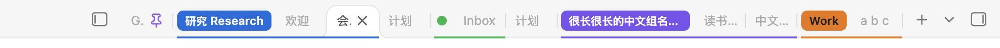
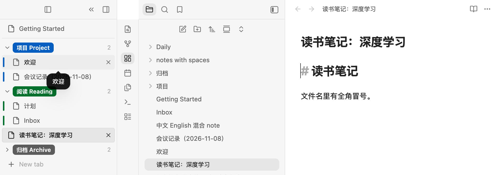

# Tabstrip

Tabstrip 给 Obsidian 自己的标签栏加上浏览器式的标签组：把标签放进有名字、有颜色、能折叠的组里，和 Chrome、Edge 一样。另有一条垂直标签栏（实验功能），在窗口最左边用列表显示同一套组。

只支持桌面端。版本 0.2.0。[English](README.md)

## 能做什么

- **在真正的标签栏上分组。** 一个组是同一个面板里相邻的几个标签。组的第一个标签前面有一个彩色的组名牌（没有名字时是一个色点），组里的标签下面有一条同色的线。共 9 种颜色，和 Chrome 一样。
- **折叠和展开。** 点组名牌，组里的标签就收到组名牌后面；再点一次展开。正在看的标签不会被藏起来：折叠它所在的组时会切到旁边的标签；被藏起来的标签变成当前标签时（原生的「跳到第 N 个标签」、上一个/下一个标签、标签列表、点链接、其他插件），它的组会自动展开。
- **拖动标签进出组**，用的就是 Obsidian 原生的标签拖动。拖动时，标签会加入的那个组会高亮。把标签拖到别的面板或窗口，它就离开原来的组。
- **重启后组还在**（每台设备各自保存）：名字、颜色、折叠状态和顺序都会恢复，主窗口和弹出窗口都一样。原生的「撤销关闭标签」会把标签放回原来的组。
- **垂直标签栏（实验）。** 一条命令把主窗口切换成最左边的竖排标签列表：先是固定的标签，然后每个面板一段，有组的行、彩色竖条、关闭按钮、拖放、完整的键盘操作，还能收成 48 px 宽的图标栏，鼠标悬停时展开。横竖两种方向共用同一套组，随时可以来回切换。
- 界面支持**英文和简体中文**，支持键盘操作、读屏和高对比模式。

## 快速上手

1. 安装并启用 Tabstrip（见[安装](#安装)）。
2. 右键一个标签，选「添加到新组」。会弹出一个小气泡：输入组名、选颜色，按 Enter 或点别处确认（Esc 撤销这次的修改）。
3. 右键同一个面板里的另一个标签，选「添加到组：…」，或者把它拖到组里的两个标签之间。
4. 点组名牌折叠这个组。右键组名牌可以重命名、换颜色、在组内新建标签、取消分组、关闭组、折叠其他组。
5. 可选：打开命令面板，运行「Tabstrip: 切换垂直标签栏（实验）」试试垂直标签栏。再运行一次就切回来。

Tabstrip 没有设置页，所有操作都通过菜单和命令完成，所有命令都没有预设快捷键。

## 横排和竖排

默认是水平标签栏。命令「切换垂直标签栏（实验）」（英文界面：Toggle vertical tabs (experimental)）在两者之间切换主窗口。它没有预设快捷键；要绑定的话，打开「设置 → 快捷键」，搜索 "Tabstrip"。

切换时保留组、固定的标签、折叠状态、标签顺序、当前标签和光标位置；布局和 `workspace.json` 都不变。选择按设备保存，重启后保持。弹出窗口始终用水平标签栏。

垂直标签栏里：

- **鼠标：** 点一行显示这个标签；中键点或点 × 关闭。右键标签是 Obsidian 自己的标签菜单（带分组的菜单项），右键组的行是组菜单。点组的行折叠或展开这个组。
- **图标栏：** 点标签栏顶部的按钮，或运行命令「收起/展开垂直标签栏」，收成 48 px 宽的图标栏。悬停时它会浮在编辑区上方展开，不挤动其他内容。
- **宽度：** 拖标签栏右边缘（或聚焦后按左右方向键），180 到 480 px。
- **键盘：** 整个列表只占一个 Tab 停留点。方向键、Home、End 移动；Enter 显示标签或折叠/展开组；空格折叠/展开组；Delete 关闭标签；F2 重命名组；Shift+F10 或菜单键打开右键菜单；Alt+上/下方向键移动标签。
- **拖放：** 拖动一行可以调整顺序、进出组。拖出标签栏后就是 Obsidian 原生的标签拖动：分屏、移到别的面板或窗口、拖到窗口外打开新窗口。

## 命令

命令都在命令面板的 "Tabstrip:" 下面，都没有预设快捷键。当前用不了的命令（比如当前标签不在组里时的「将当前标签移出组」）不会出现在命令面板里。完整的命令表（中英文名称对照）见[英文说明](README.md#commands)。

| 命令 | 作用 |
|---|---|
| 将当前标签添加到新组 | 用当前标签建一个新组，并打开命名气泡 |
| 将当前标签移出组 | 把当前标签移出它的组 |
| 重命名当前组 | 打开当前标签所在组的命名气泡 |
| 折叠/展开当前组 | 折叠或展开当前标签所在的组 |
| 跳到下一个标签（跳过折叠的组） / 跳到上一个标签（跳过折叠的组） | 和原生的上一个/下一个标签一样，但不会打开折叠的组 |
| 把当前标签往上（左）移一格 / 往下（右）移一格 | 把当前标签移动一格；在组的边上进组或出组也算一步 |
| 切换垂直标签栏（实验） | 在水平标签栏和垂直标签栏之间切换 |
| 收起/展开垂直标签栏 | 在完整宽度和图标栏之间切换 |
| 恢复原生标签栏 | 去掉 Tabstrip 的全部装饰（包括垂直标签栏），组仍保留 |
| 重新显示标签组 | 撤销「恢复原生标签栏」 |
| 恢复未匹配的组 | 对启动时没找到标签的组再匹配一次（比如在你打开了它们的文件以后） |
| 清除本机数据（英文界面：Clear data on this device） | 删除 Tabstrip 在本机为这个仓库保存的数据，执行前会先确认 |

## 安装

Tabstrip 还没有上架社区插件市场。上架之前请手动安装：

1. 从最新的 [Release](https://github.com/huzibo-yyds/obsidian-tabstrip/releases) 下载 `main.js`、`manifest.json` 和 `styles.css`。
2. 把它们放进 vault 的 `.obsidian/plugins/tabstrip/` 文件夹。
3. 重新加载 Obsidian，然后在 **设置 → 第三方插件** 里启用 Tabstrip。

上架之后：**设置 → 第三方插件 → 浏览**，搜索「Tabstrip」。

## 保存的数据和卸载

Tabstrip 只在你使用它的设备上写**一项**数据：这个仓库在本机的本地存储（`app.saveLocalStorage`，不同步）里的 `tabstrip-session-v1`。里面是已打开的组、最近关闭的约 25 个组成员、未匹配的组、标签栏方向（只在竖排时）、垂直标签栏的宽度和图标栏状态（只在不是默认值时），以及格式版本号。

它不往仓库里写任何东西：没有 `data.json`，也不改 `workspace.json`，所以组不会在设备之间同步。停用插件时这项数据保留（再次启用会恢复组）。要删除它，先运行「清除本机数据」（会先确认），再停用或卸载插件；每台设备、每个用过 Tabstrip 的仓库都要各运行一次。清除和卸载都不会关闭任何标签。更多细节见[英文说明](README.md#stored-data-and-uninstalling)。

## 兼容性和已知限制

- 只支持桌面端，需要 Obsidian 1.13.0 或更新版本。
- 在 macOS 上用 Obsidian 1.13.4、1.14.4、1.15.0 做过自动化端到端测试和手动测试。**还没在 Windows 和 Linux 上测过。**
- 测过的主题：默认主题和 Atom，浅色、深色都测过，水平标签栏和垂直标签栏都测过。Minimal（含它的 Modern 标签样式）、Cupertino、Blue Topaz（含它的 Safari 标签样式）只在浅色模式、水平标签栏下测过，没测深色模式和垂直标签栏。分组颜色取自主题的颜色变量，其他主题和模式应该也能用；如果遇到不正常的，欢迎反馈。
- Tabstrip 会读取 Obsidian 工作区的几个内部部分（标签头、标签容器和其中的标签），并用 Obsidian 自己移动标签的方法，但不改写 Obsidian 的代码。启动时先检查这些部分是否都在；如果以后的 Obsidian 版本改了其中某项，依赖它的功能会关闭，原生标签栏保持原样。
- 堆叠标签模式下，组只显示颜色，不能折叠。
- 弹出窗口始终是水平标签栏。关闭的弹出窗口里的组会记下来，但暂时还不能恢复。
- 竖排模式下拖放的限制（因为原生标签行被隐藏了）：普通面板不能「向上分屏」（编辑区顶部算作中间）；拖到面板中间时，标签会放到这个面板的末尾，而且没有位置提示。堆叠的面板保留全部落点。垂直标签栏只接受从它自己的行里拖出来的标签。
- 还没有：整组拖动、标签搜索、保存的组、弹出窗口里的垂直标签栏。
- 没有设置页。
- 没有和其他标签类插件一起测过。检测到 Vertical Tabs 插件好像已启用时，会提示两者功能重叠（每次启动提示一次，横排竖排都会），但不会停用它。

## 和 Vertical Tabs 的区别

Vertical Tabs 在侧边栏视图里画标签列表，它的「分组」其实是面板（分屏），不是标签组。Tabstrip 把面板里的**标签**分组；组直接显示在 Obsidian **自己的水平标签栏**上，同一套组也能显示在可选的垂直标签栏上；垂直标签栏在窗口最左边，和文件列表并排，能收成图标栏、能调宽度。两个插件不要同时启用。

## 术语

- **面板**：分屏得到的标签容器。Obsidian 中文界面叫「标签页组」，Tabstrip 叫它「面板」，免得和标签组混淆。
- **组 / 标签组**：Tabstrip 的组，即同一个面板里相邻的、有名字和颜色的一串标签。
- **组名牌**：水平标签栏上组的第一个标签前面的彩色小块，点它折叠或展开。
- **未匹配的组**：启动时没找到对应标签的已保存组，留着等「恢复未匹配的组」再匹配。

## 隐私

Tabstrip 不联网，不收集任何数据。

## 许可证

[MIT](LICENSE)
